# F1RaceAnalytics

A Python **Formula 1 race simulator** that generates a realistic, relational synthetic dataset (2 seasons, 48 races, ~55k laps), plus an analytics stack on top of it: **SQL**, **Power BI**, and **Tableau**.

All teams and drivers are fictional. Everything is reproducible from a random seed.

## What's inside

| Layer | Tools | Folder |
| --- | --- | --- |
| Simulation / data generation | Python, NumPy | `src/f1_simulator.py` |
| BI-ready tables (star schema + flat) | pandas | `src/build_bi_exports.py` |
| SQL analysis (joins, window functions, CTEs) | SQLite / Postgres | `sql/` |
| Dashboards | Power BI | `powerbi/` |
| Dashboards | Tableau | `tableau/` |

## Quick start

```bash
pip install -r requirements.txt
python src/f1_simulator.py 42 data/raw     # generate raw tables (seed, output dir)
python src/build_bi_exports.py             # build Power BI / Tableau tables in data/bi
python src/build_sqlite.py                 # optional: load into SQLite (data/f1.db)
sqlite3 data/f1.db < sql/analysis_queries.sql
```

Change the seed (`python src/f1_simulator.py 7`) to generate a different universe.

## Data model

```mermaid
erDiagram
    constructors ||--o{ drivers : employs
    constructors ||--o{ race_results : scores
    circuits ||--o{ races : hosts
    races ||--o{ qualifying : has
    races ||--o{ race_results : has
    races ||--o{ pit_stops : has
    races ||--o{ lap_times : has
    drivers ||--o{ qualifying : takes
    drivers ||--o{ race_results : earns
    drivers ||--o{ pit_stops : makes
    drivers ||--o{ lap_times : drives
```



| Table | Rows | Grain |
| --- | --- | --- |
| constructors | 10 | one per team |
| drivers | 20 | one per driver |
| circuits | 24 | one per track |
| races | 48 | one per race (2 seasons x 24) |
| qualifying | 960 | driver x race |
| race_results | 960 | driver x race |
| pit_stops | ~1,700 | one per stop |
| lap_times | ~55,000 | driver x race x lap |

## How the simulation works

- Each team has a car pace delta and a reliability rating; each driver has a skill offset and a drifting "form" value, so results are correlated but not predictable.
- Lap time = circuit base time + car + driver + tyre wear (by compound and age) + fuel burn-off + noise + dirty-air penalty when following closely.
- Weather (circuit-specific rain probability), safety cars that bunch the field, and cheaper pit stops under a safety car.
- Qualifying with occasional grid penalties, one to three pit stops per race, mechanical failures and crashes.
- Realistic gaps: occasional missing humidity, attendance, pit duration and qualifying times; retired drivers have no finish time.
- Points: 25-18-15-12-10-8-6-4-2-1, plus 1 point for fastest lap inside the top 10.

## SQL

`sql/analysis_queries.sql` holds 12 queries: championship standings, running points with window functions, constructor standings, win rate by grid slot, tyre degradation, pit stop performance, DNF rates, wet vs dry form, teammate head-to-head (self join), LAG-based position changes, and ranked fastest laps.

## Dashboards

- Power BI: star schema, DAX measures and build guide in [`powerbi/`](powerbi/README.md)
- Tableau: flat tables, calculated fields and dashboard specs in [`tableau/`](tableau/README.md)

Add screenshots to `powerbi/screenshots/` and `tableau/screenshots/`, then embed them here:

```markdown


```


